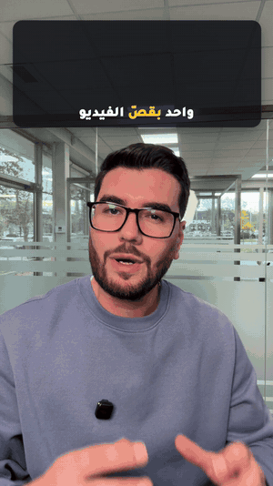

<div dir="rtl">

<p align="center"></p>

<p align="center"><b>تحكي للكاميرا… وClaude بيرجعلك الريل جاهز للنشر.</b><br>
بيقص ويشيل السكتات، بيكتب هوك وكابشن عربي بتوقيت كل كلمة، وبيرسم موشن غرافيك من معنى كلامك. كله بملف MP4 واحد، بدون أي برنامج مونتاج، والفيديو ما بيطلع من جهازك.</p>

<p align="center"><a href="https://github.com/ahmadalsakka1994/alsakka-video/releases/latest/download/alsakka-video.plugin"></a></p>

## ⚡ التثبيت

> ☝️ **اختار طريقة وحدة بس.** إذا ثبّتته بأكتر من طريقة، بيصير عندك نسخ مكررة.

### الطريقة الأولى (الأسهل): من تطبيق Claude، وبيتحدّث لحاله
1. افتح تطبيق **Claude** للديسكتوب، وروح على **Customize** ← **Plugins** ← **Add** ← **Add marketplace**
2. الصق هاد الاسم:
<div dir="ltr">

```
ahmadalsakka1994/alsakka-video
```

</div>

3. فعّل **Sync automatically** وضيف البلجن `alsakka-video`.

### الطريقة التانية: حمّل وارفع
1. اضغط الزر الأصفر فوق، فبيتحمّل ملف `alsakka-video.plugin`.
2. بتطبيق **Claude** روح على **Customize** ← **Plugins** ← **Upload plugin** واختار الملف.

> ⚠️ هالطريقة ما بتتحدّث لحالها. كل نسخة جديدة لازم تحمّلها وترفعها من جديد.

### الطريقة التالتة: من الـTerminal
<div dir="ltr">

```
claude plugin marketplace add ahmadalsakka1994/alsakka-video
```

```
claude plugin install alsakka-video@alsakka
```

</div>

بعدها سكّر `claude` وافتحه من جديد.

---

## 🎬 كيف تستعمله

<table width="100%"><tr>
<td width="33%" align="center" valign="top"><h3>1️⃣</h3><b>أول مرة بس</b><br><sub>بتاب <b>Code</b> بتطبيق Claude اكتب:</sub><br><code>جهّز البلجن</code><br><sub>بيثبّت الأدوات الناقصة لحاله</sub></td>
<td width="33%" align="center" valign="top"><h3>2️⃣</h3><b>اسحب الفيديو للمحادثة</b><br><sub>واكتب:</sub><br><code>منتجلي هالفيديو</code><br><sub>(ولو عندك السكربت حطه، بيساعده بالكلمات)</sub></td>
<td width="33%" align="center" valign="top"><h3>3️⃣</h3><b>استلم الـMP4</b><br><sub>بدك تغيّر شي؟ احكيله:</sub><br><code>غيّر الهوك</code> · <code>الكلمة الفلانية غلط</code></td>
</tr></table>

> ⏳ أول خطوة بتاخد وقت لأن Claude بيسمع الفيديو كلمة كلمة: فيديو دقيقة ممكن ياخد 5 لـ10 دقايق على الجهاز.

---

## ✨ شو بيعمل

<table width="100%"><tr>
<td width="25%" align="center" valign="top"><br><b>هوك من أول ثانية</b><br><sub>لوغو حقيقي بينشطب وبينقلب. الهوك مكتوب بكلامك إنت</sub></td>
<td width="25%" align="center" valign="top"><br><b>بيقص ويشيل السكتات</b><br><sub>مقص 3D بيقص فريمات فيديوك الحقيقية</sub></td>
<td width="25%" align="center" valign="top"><br><b>موشن من معنى كلامك</b><br><sub>مكتبة مشاهد، وفهرس 234 فكرة موشن للإلهام</sub></td>
<td width="25%" align="center" valign="top"><br><b>الفيديو جوّا التايملاين تبعه</b><br><sub>الكاميرا بترجع لورا وبتوريك المونتاج نفسه</sub></td>
</tr></table>

- **كابشن عربي** بتوقيت كل كلمة، تحت الدقن بالزبط (ما بيغطي وجهك)، والكلمات المهمة بلون مختلف
- **زوم وترانزيشن** بين اللقطات، وشي بيتغيّر على الشاشة كل 4 ثواني بالأكتر
- **ساوند إفكت خفيفة** على اللحظات المهمة بس، وصوت مضبوط على مستوى إنستغرام
- **أكتر من هوك؟** بيحط أحسن واحد بالبداية، وبيعملك نسخ Trial Reels بالهوكات التانية
- **بدك تعدّل بإيدك؟** اختياري: «حطّه كمان بكاب كت»، وبينكتب كل شي على تايملاين بتقدر تعدّله

## 🧰 يلي بتحتاجه
**Mac** · **Google Chrome** · **Claude Code** (تاب Code بتطبيق Claude). والباقي (ffmpeg وwhisper…) بيثبّته «جهّز البلجن».

## 📖 الشرح الكامل
[دليل_الاستخدام.md](دليل_الاستخدام.md): كل شي بالتفصيل، الأشياء يلي بتقدر تطلبها، وشو تعمل إذا صار شي.

## 🙏 شكر
- **ماجد الزعابي ([majed-video](https://github.com/majedphotos/video-ad-editor)):** هالبلجن طلع من شغله. أخدنا من بلجنه (رخصة MIT) أفكار وأجزاء، وعدّلنا عليهم ليناسبوا طريقتنا. نص رخصته بـ[`assets/MAJED_LICENSE.txt`](assets/MAJED_LICENSE.txt).
- **[prompt-motion.com](https://prompt-motion.com):** فهرس أعمال الموشن يلي منستعمله للإلهام. كل عمل لصاحبه.
- **خط Tajawal:** رخصة OFL.

<p align="center">صنعه <a href="https://www.instagram.com/ahmad.alsakka.official">أحمد السقا</a> مع Claude · رخصة MIT</p>

</div>
